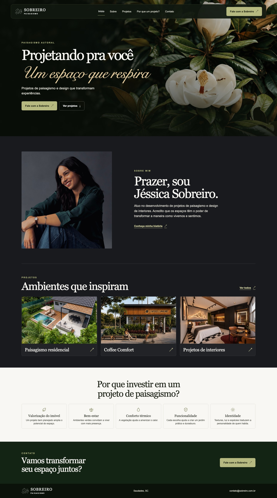
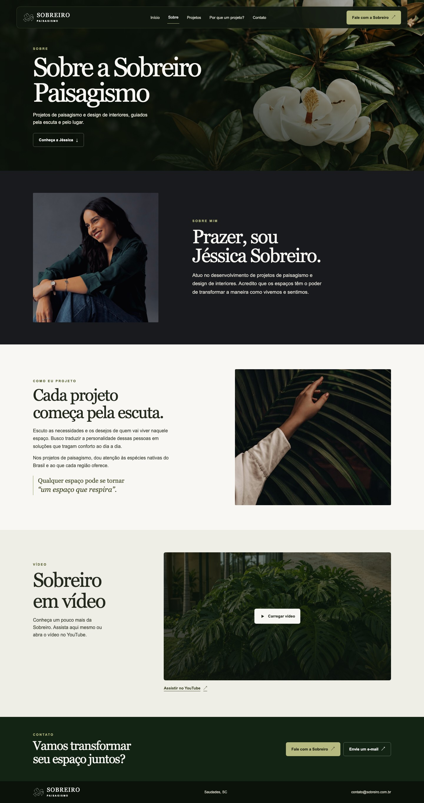
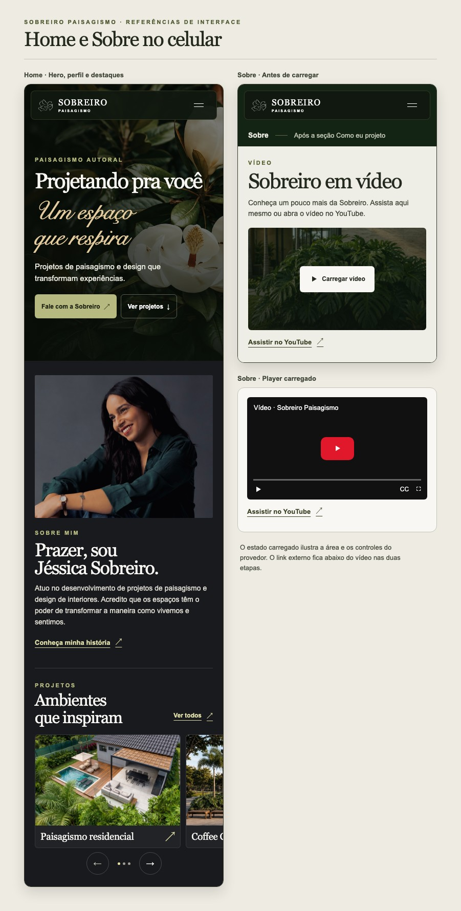
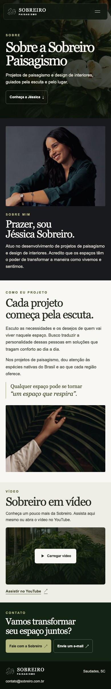

# TDD · Alinhamento do site ao briefing da cliente

**Sobreiro Paisagismo · Proposta para revisão · 8 de novembro de 2026**

O site já tem Home, Sobre, catálogo de projetos e páginas de detalhe. Esta proposta atualiza a Home e reaproveita a estrutura da página Sobre para apresentar Jéssica, explicar sua abordagem e oferecer o vídeo na própria página.

## 1. Requisitos e origem

| Origem | Requisito | Aplicação proposta |
| --- | --- | --- |
| Briefing, p. 1 | Novo título, lettering parecido com a referência e novo texto de apoio | H1 “Projetando pra você um espaço que respira”, com a segunda parte em manuscrita. Apoio “Projetos de paisagismo e design que transformam experiências”. |
| Briefing, p. 2 | Logo branca no cabeçalho | Aplicar branco ao símbolo e ao nome da marca, no cabeçalho global desktop e mobile. |
| Briefing, p. 2, portfólio, p. 2, e retrato anexo | “Sobre mim” na primeira página, com texto do portfólio e foto indicada | Usar o retrato enviado em `IMG_6183 (1).PNG` e a apresentação em primeira pessoa, logo depois do hero. O link “Conheça minha história” leva a `/sobre`. |
| Briefing, p. 2 | Projetos abaixo do Sobre mim e benefícios por último | Ordem proposta da Home: hero → Sobre mim → Projetos → Benefícios → Contato → Rodapé. Benefícios encerram o conteúdo editorial, antes do CTA de contato. |
| Briefing, p. 3, e portfólio, pp. 6–8 | Fundo dos projetos em cinza quase preto e três capas na ordem indicada | Paisagismo residencial com vista aérea, Coffee Comfort com fachada frontal e Projetos de interiores com a suíte. No card, a capa e o título fazem a identificação. |
| Briefing, p. 3 | Manter o trabalho de jardins verticais fora da Home com o nome indicado | “Jardins verticais” no catálogo e no detalhe publicado, com URL estável. |
| Pedido no chat e portfólio, pp. 2–4 | Reaproveitar a estrutura de Sobre e contar quem é Jéssica e como ela trabalha | Manter as seções de abertura, perfil, essência e contato. Usar o retrato enviado e a narrativa do portfólio em primeira pessoa. |
| Pedido adicional no chat | Vídeo do YouTube no Sobre | Player incorporado na própria página, depois da apresentação e da abordagem de Jéssica, antes do contato. |
| Briefing, p. 4 | Aprovação geral do restante | Intervenção localizada no site existente. A lista de serviços do portfólio, p. 5, é material de contexto. |

### Texto de “Sobre mim”

**Sobre mim**  
**Prazer, sou Jéssica Sobreiro.**

> Atuo no desenvolvimento de projetos de paisagismo e design de interiores. Acredito que os espaços têm o poder de transformar a maneira como vivemos e sentimos.

A proposta preserva o texto do portfólio, com ajustes de capitalização e pontuação para a leitura no site. “Projetando pra você” mantém o tom do briefing.

## 2. Referências visuais de UI/UX

Mockups da proposta com fotografia do site, retrato enviado e as três capas conferidas no Drive. As telas mobile mostram os trechos alterados da Home e de Sobre.

### Home · Desktop

Hero fotográfico com a marca branca. O manuscrito entra uma vez como assinatura do título. A seção Sobre mim toma emprestados do portfólio o fundo escuro, a composição retrato/texto e a apresentação em primeira pessoa. No carrossel, as capas ganham protagonismo com títulos curtos.

### Sobre · Desktop

Página completa. A abertura leva ao perfil de Jéssica. Depois do retrato e da apresentação, “Como eu projeto” explica a escuta, o conforto e a escolha de espécies nativas. O vídeo complementa a leitura e antecede o contato.

### Home e Sobre · Mobile

Na Home, o retrato fica acima do texto e a prévia do próximo card sinaliza o deslize horizontal. Em Sobre, as seções ficam em uma coluna e o player ocupa a largura de leitura. A prancha de interação também ilustra o estado após carregar o YouTube.

## 3. Decisões de implementação

### Home e navegação

- Reordenar as seções em `app/page.tsx` e atualizar as strings em `app/_home/homeContent.ts`. Manter `#projetos`, `#sobre`, `#beneficios`, `#contato` e os destinos do menu. Aplicar o espaçamento de âncoras do cabeçalho também após a reordenação.
- Em `HeroSection`, compor um único H1 textual com fragmento manuscrito. Reutilizar Georgia e a pilha sans para os demais papéis. A manuscrita da prancha é uma aproximação visual. Para produção, homologar um arquivo WOFF2 licenciado com acentos de português, hospedá-lo localmente e testar o fallback em Georgia itálico. Restringir a família à frase de destaque.
- Adaptar `AboutPanel` para retrato e narrativa em duas colunas, empilhadas no mobile. Usar uma versão WebP do PNG indicado, com dimensões intrínsecas, `sizes` e recorte que preserve rosto e postura. Na Home, a introdução do portfólio ocupa o espaço editorial antes dedicado à citação.
- Em `SiteHeader` e `BrandLockup`, aplicar a variante branca da flor e a cor branca ao wordmark por meio do componente compartilhado. O SVG `flor-sobreiro-vetor-branca.svg` já existe. O cabeçalho deve oferecer fundo escuro suficiente para leitura sobre fotos e superfícies claras.
- Em `app/globals.css` e nos tokens existentes, manter a identidade de floresta e oliva do hero, creme nas superfícies claras e usar o carvão `#191A1D` como proposta de superfície para o perfil editorial e a vitrine. Revisar contraste dos pares reais e do H1 sobre a fotografia. Em telas estreitas, deixar o texto quebrar naturalmente e conter a rolagem horizontal na trilha de projetos.

### Projetos e mídia

| Posição | Título na Home | Capa | Destino |
| --- | --- | --- | --- |
| 1 | Paisagismo residencial | Vista aérea diurna da residência com piscina e área gourmet, 2752 × 1536 px. [FOTO 1.jpeg](https://drive.google.com/file/d/1wPr39Kl5vUe8D72eV2K6Lfc3nmJgenjf/view) | Detalhe do novo projeto após publicação. Enquanto estiver pendente, catálogo filtrado por `paisagismo-residencial`. |
| 2 | Coffee Comfort | Fachada frontal da cafeteria, 895 × 652 px. Usar a versão já recortada para a capa. [FOTO DE CAPA.jpg](https://drive.google.com/file/d/1mA-mjrXMEj4IMFFCTB6EO3BSzlaVudgC/view) | `/projetos/coffee-comfort`. |
| 3 | Projetos de interiores | Vista ampla da suíte com painel iluminado atrás da cama, 1678 × 937 px. [FOTO 1.png](https://drive.google.com/file/d/1T2d29GVxbTg1XyHN1YS3QLztEFwsSGzQ/view) | Detalhe da nova suíte após publicação. Enquanto estiver pendente, catálogo filtrado por `design-de-interiores`. |

- A pasta compartilhada contém seis imagens residenciais, uma capa comercial e cinco imagens de interiores. Os arquivos `FOTO 3.png` e `FOTO 3.jpeg` em interiores mostram ângulos diferentes. Na importação, usar nomes descritivos para as mídias selecionadas e confirmar com a cliente os títulos de ficha e a classificação das imagens como foto ou render. [Pasta ORDEM DOS PROJETOS INICIAIS](https://drive.google.com/drive/folders/1ijbckYQ73wFUqTNwxOKbCgTwrPw7wqzD)
- Manter `images/portfolio/catalog.json` como fonte de projetos, mídia e status de publicação. A residência do Drive tem acervo distinto do projeto `residencia-piscina-area-gourmet`. A suíte também é uma entrada nova. Cadastrar os dois com IDs próprios e atualizar `projectPresentations` junto com o catálogo. Para Coffee Comfort, associar a nova capa ao projeto existente e usá-la no destaque da Home.
- Evoluir `home-catalog.json` para aceitar título e arquivo de capa opcionais por destaque, além do ID e da ordem. Em `portfolioCatalog.ts`, validar exatamente três IDs e ordens únicos e verificar que a capa pertence ao projeto referenciado. Derivar o card da Home com esse título e capa, usando o detalhe publicado quando houver ou o filtro válido do catálogo para residencial e interiores. O rótulo acessível do link deve nomear o destino real.
- Usar uma apresentação compacta de `ProjectCard` no `ProjectCarousel`. A Home mostra apenas capa e título, com seta decorativa no link. Catálogo e detalhe continuam usando a apresentação completa. Preservar controles de toque, teclado e foco do carrossel, com três cards visíveis quando houver espaço.
- Atualizar o título de `jardim-vertical-residencial` para “Jardins verticais”, incluindo metadados e H1 onde derivam do título. Remover só sua referência em `home-catalog.json`. Manter a categoria, a galeria e o slug.

### Página Sobre e conteúdo editorial

A ordem proposta é **hero → perfil → essência → vídeo → contato → rodapé**. A página começa com quem é Jéssica e amplia a apresentação da Home com a forma como ela projeta. Os textos abaixo são versões editoriais para o site baseadas nas pp. 2–4 do portfólio.

| Seção | Conteúdo e comportamento |
| --- | --- |
| Abertura | H1 “Sobre a Sobreiro Paisagismo” e texto “Projetos de paisagismo e design de interiores, guiados pela escuta e pelo lugar.” A ação “Conheça a Jéssica” leva a `#perfil`. |
| Perfil | “Prazer, sou Jéssica Sobreiro.” Usar o retrato já escolhido para a Home e a apresentação em primeira pessoa da p. 2, com retrato e texto lado a lado no desktop. |
| Essência · Como eu projeto | “Cada projeto começa pela escuta.” Usar a narrativa abaixo ao lado da imagem da mão tocando uma folha, referência visual da p. 3 do portfólio. Em telas estreitas, o texto precede a imagem. |
| Vídeo | “Sobreiro em vídeo”, com poster local, botão de ativação e link direto para o YouTube. |
| Contato | Convite “Vamos transformar seu espaço juntos?”, com os canais de WhatsApp e e-mail já usados na rota. |

**Texto proposto para “Como eu projeto”**

> Escuto as necessidades e os desejos de quem vai viver naquele espaço. Busco traduzir a personalidade dessas pessoas em soluções que tragam conforto ao dia a dia.
>
> Nos projetos de paisagismo, dou atenção às espécies nativas do Brasil e ao que cada região oferece.
>
> Qualquer espaço pode se tornar “um espaço que respira”.

- Em `app/sobre/page.tsx`, reordenar `AboutHero`, `TeamProfileSection` e `EssenceSection`, e reutilizar `ContactMethodsSection` e o rodapé compartilhado. Reaproveitar as composições de retrato, imagem e texto. No perfil e na essência, concentrar o espaço editorial no texto do portfólio, com a identidade de Jéssica apresentada diretamente no título.
- Em `aboutContent.ts`, manter o conteúdo da rota em português, com textos, retrato e mídia tipados. Dar ao perfil o ID `perfil` e manter `essencia` na seção de abordagem para que o endereço `/sobre#essencia` continue válido. Usar headings reais e o recuo de âncora do cabeçalho global.

### Player em `/sobre`

Em `app/sobre/aboutContent.ts`, guardar ID, rótulo, poster local e URL externa como conteúdo estático. Compor uma seção semântica em `app/sobre/page.tsx` e isolar a ativação em um Client Component local, por exemplo `AboutVideoPlayer`. O conteúdo editorial da página é renderizado no servidor e fica disponível antes de carregar o player.

**Sobreiro em vídeo**

> Conheça um pouco mais da Sobreiro. Assista aqui mesmo ou abra o vídeo no YouTube.

| Estado | Experiência |
| --- | --- |
| Inicial | Mostrar o texto da seção, o poster local, o botão “Carregar vídeo” e o link “Assistir no YouTube”. |
| Ativado | Inserir o iframe no espaço reservado e mover o foco para ele com rótulo descritivo. A reprodução começa pelo controle do player. A página permanece em `/sobre`. |
| Incorporação indisponível, rede bloqueada ou JavaScript desativado | Manter o link externo visível. Com JavaScript desativado, o link é o controle disponível. Quando o iframe exibir uma mensagem do provedor, a alternativa continua logo abaixo. |

- URL do iframe `https://www.youtube-nocookie.com/embed/Rvv5bZX8TZs?playsinline=1&hl=pt-BR`. Link externo `https://www.youtube.com/watch?v=Rvv5bZX8TZs`. Usar controles nativos, tela cheia e título acessível. Evitar requisições de mídia, preconnect ou miniatura do YouTube antes de ativar o player ou escolher o link externo.
- Reservar 16:9 onde houver espaço e manter pelo menos 200 × 200 px de área do iframe, inclusive em 320 px. Usar o mesmo espaço antes e depois da ativação para evitar deslocamento da página. Verificar legendas em português no vídeo e aprovar a alternativa textual aplicável ao conteúdo antes de publicar. [Parâmetros oficiais do player](https://developers.google.com/youtube/player_parameters)
- O `Referrer-Policy` atual é `strict-origin-when-cross-origin`. Usar essa política no iframe para preservar o referenciador necessário ao player. O CSP atual contém `frame-ancestors 'none'`, que protege o site como alvo de incorporação. Se a política ganhar restrição para frames carregados pela página, autorizar `https://www.youtube-nocookie.com` via `frame-src` no escopo de `/sobre`. A troca de domínio usa o modo de privacidade avançada do YouTube, e o clique adia a conexão com o serviço. [Ajuda oficial do YouTube](https://support.google.com/youtube/answer/171780?hl=pt-BR)
- Tratar a disponibilidade do vídeo como dependência de aceite. A consulta ao link e ao endpoint de incorporação neste planejamento não confirmou reprodução. Validar no domínio de prévia, em sessão anônima e em Safari/iOS e Chrome/Android. Se o vídeo bloquear incorporação, confirmar a opção “Permitir incorporação” com a titular e usar o link direto como alternativa.

## 4. Aceite e entrega

| Área | Evidência esperada |
| --- | --- |
| Home | Um H1, frase manuscrita em texto, símbolo e nome brancos, retrato indicado, ordem correta no DOM e âncoras visíveis abaixo do cabeçalho. |
| Projetos | Três destaques na ordem combinada, capas conferidas com os originais, card só com título e imagem, links válidos e Jardins verticais acessível no catálogo. URLs já publicadas respondem normalmente. |
| Sobre | Hero, retrato e introdução em primeira pessoa, abordagem com escuta, conforto e espécies nativas, vídeo e contato nessa ordem. A âncora do hero leva ao perfil. O texto editorial fica disponível antes da ativação do player. Poster e link externo visíveis de saída. Após a ativação, iframe na página e reprodução por controle nativo, com foco previsível e fallback visível. |
| Responsividade e acessibilidade | Inspeção em 320, 390, 768 e 1440 px. Sem sobreposição de texto ou rolagem horizontal na página. Teclado, foco visível, leitor de tela, contraste WCAG 2.2 AA, alvos de 44 × 44 px e movimento reduzido. |
| Validação técnica | Cobrir ordem/âncoras, destaque e validação de dados, fallback e ativação do player na suíte Jest existente. Executar `npx tsc --noEmit`, `npm run lint`, `npm test -- --runInBand` e `npm run build` no Node declarado pelo projeto. |

Publicar primeiro em prévia e conferir se as imagens importadas correspondem aos arquivos da tabela, além do lettering, dos destinos e da incorporação no domínio. O plano de reversão é republicar a versão anterior do site, com conteúdo e ativos daquela versão. A mudança consiste em código e mídia versionáveis.

**Pendências de publicação** · Importação dos arquivos conferidos, cadastro dos dois projetos e aprovação dos dados de ficha, da fonte, do texto adaptado de Sobre, da imagem de abordagem para uso na web e do poster. Testar a reprodução incorporada e a acessibilidade do vídeo na prévia. O TDD propõe os benefícios antes do contato na Home, a apresentação compacta dos destaques e o vídeo depois da narrativa em Sobre.

## 5. Materiais consultados

- Briefing “PODE ESCREVER AQUI — PROJETANDO PRA VOCÊ ‘UM ESPAÇO QUE RESPIRA’”, pp. 1–4. Define as mudanças pedidas e identifica a pasta de imagens.
- Portfólio de Jéssica Sobreiro, pp. 2–4 para linguagem editorial e pp. 6–8 para as capas. O retrato de revisão vem do anexo `IMG_6183 (1).PNG`.
- Arquivos de capa e acervos para a Home. [Pasta compartilhada do Drive](https://drive.google.com/drive/folders/1ijbckYQ73wFUqTNwxOKbCgTwrPw7wqzD)
- Vídeo enviado no chat. [Abrir no YouTube](https://youtu.be/Rvv5bZX8TZs?si=APEoT3wIkWu6F_fJ)
- Padrões do repositório e mapeamento existente de Sobre. [Coding patterns](CODING-PATTERNS.md) · [Design system](DESIGN-SYSTEM.md) · [UI map de Sobre](UI-MAP-SOBRE-DESKTOP.md)
